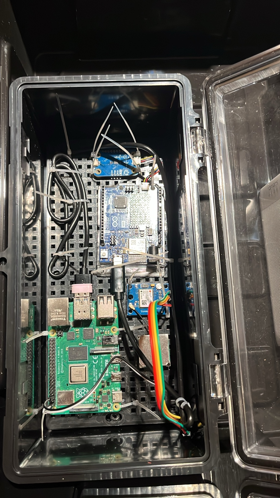

# SOLSTRÅLE

**ASV-01 · Autonomous Surface Vessel**

*The Pi, Arduino, GPS, and IMU mounted inside the electronics box.*

SOLSTRÅLE is a small catamaran I am building on my own to learn more about robotics. I wanted to work on the whole boat, including the hull, wiring, motor control, sensors, and ROS 2 software.

A lot of the learning happens when something does not work as expected. Getting the motors to behave means checking the code, wiring, and drivers together. Keeping water out of the electronics also makes cooling harder, especially in Florida. I like having a physical project where I can work through these problems myself.

Eventually, I want to collect camera, GPS, IMU, and control data from the boat and use it for sensor-fusion and perception experiments. Obstacle avoidance and autonomous docking are longer-term goals.

## Where I am now

The electronics and thrusters are installed, and I can drive the boat from the control station. Manual control, the thrusters, IMU, RGB camera, and E-stop have been tested. I still have small fixes to work through and more testing to do.

The software has manual control, a web dashboard, waypoint navigation, heading estimation, and Gazebo simulation. I have used simulation to develop the controls before trying them on the physical boat. The camera also has optional YOLO detection, but the default model is a placeholder.

Right now I am focused on the engineering: wiring, mounting, sealing, and getting the controls to behave consistently. Recording and data collection have not started yet. The tools are implemented, but I will test that workflow once the boat is ready.

| Part of the project | Done so far | Next work |
|---|---|---|
| Hull | Structure assembled; electronics and thrusters installed | Finish sealing and document loaded flotation |
| Motors | Both thrusters work through the control station | Load, temperature, current, and connection-loss tests |
| Dashboard | Manual drive, RGB camera, IMU, and E-stop tested | Test handover, cancellation, and reconnects |
| Navigation | Heading estimator and simulated waypoint following | Verify GPS fix, calibrate sensors, and test on water |
| Perception | YOLO and dock-marker detection code | Train and evaluate a model for the boat |
| Recording | Recorder and processing scripts implemented | First recording and data-collection test |

## Hardware

- Raspberry Pi 4
- Arduino Uno R4 WiFi with a Modulino Movement IMU
- NEO-6M GPS
- RGB Pi camera with thermal; RGB tested, thermal not tested yet
- Two brushed thrusters with BTS7960 motor drivers
- 3S LiPo for propulsion, with a 12 A fuse
- Separate power bank for the Pi and Arduino

## Build and run

The repository root is the ROS 2 workspace. With ROS 2 Jazzy and the required dependencies available:

~~~bash
colcon build --symlink-install
source install/setup.bash
~~~

For simulation:

~~~bash
ros2 launch boat_simulation boat_simulation.launch.py
~~~

For the physical boat, after checking the hardware:

~~~bash
ros2 launch boat_bringup boat_bringup.launch.py
~~~

Run one launch at a time. The dashboard is at `http://<host-ip>:5000`, and Foxglove connects at `ws://<host-ip>:8765`.

The hardware launch limits motor commands to 30% while I am testing. See [hardware bring-up](docs/06_hardware_bringup.md) for the checks and [simulation](docs/07_simulation.md) for the development setup.

## Documentation

1. [Project overview](docs/01_project_overview.md)
2. [System architecture](docs/02_system_architecture.md)
3. [Electrical system](docs/03_electrical_system.md)
4. [Mechanical design](docs/04_mechanical_design.md)
5. [Software architecture](docs/05_software_architecture.md)
6. [Hardware bring-up](docs/06_hardware_bringup.md)
7. [Simulation](docs/07_simulation.md)
8. [Data collection](docs/08_data_collection.md)
9. [Test log](docs/09_test_log.md)
10. [Known gaps and next steps](docs/10_known_gaps.md)

## Files

~~~text
src/        ROS 2 packages
firmware/   Arduino controller and bench sketches
scripts/    Bench tools, simulation helpers, and data processing
tests/      Regression tests
docs/       Project documentation
evidence/   Build photos and test-record template
~~~

## What I am working toward next

I want to finish the remaining engineering work and test what happens when communication is lost. After that, I can work through flotation and water testing and start collecting data.

## License

MIT. See `LICENSE`.
