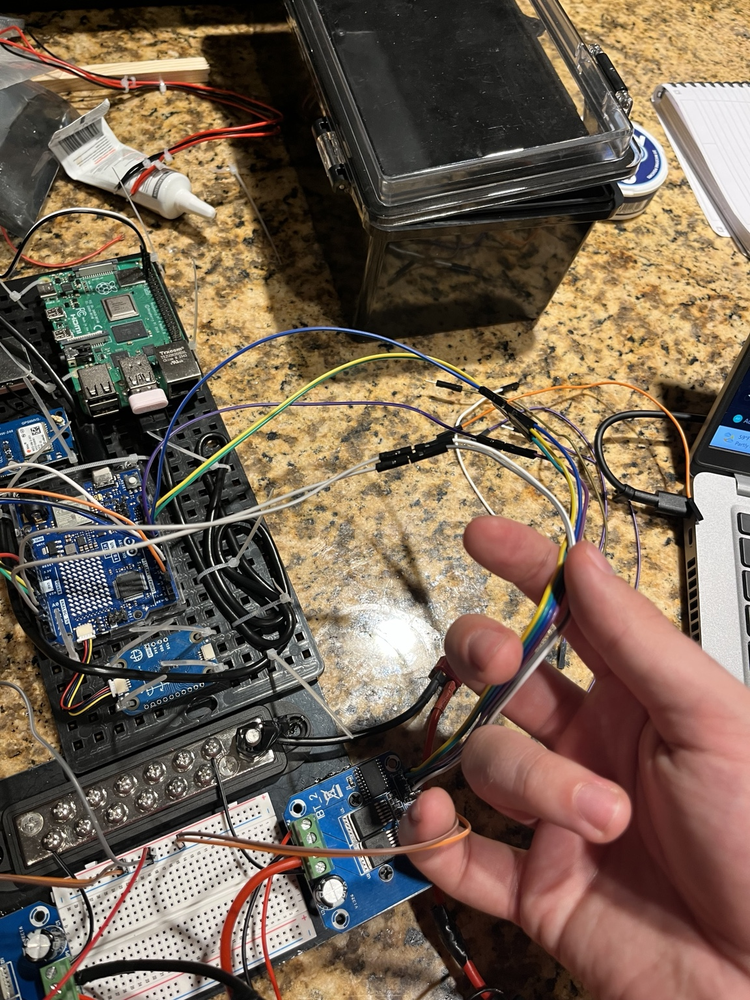

# Electrical system

[Back to README](../README.md)

I have moved the electronics from the bench into their box and installed the thrusters. I can drive the boat from the control station. The wiring still needs some tidying and smaller fixes, but the main connections are working.

## From bench wiring to the enclosure

*Working on the wiring before putting the electronics into the box.*

*The Pi, Arduino, GPS, and Modulino mounted inside the box. I glued the mounting pieces in place and used cable ties to organize the wiring.*

## Power

A 3S LiPo supplies the motors through a 12 A fuse. A separate power bank supplies the Raspberry Pi and Arduino.

I still need to finish the wiring diagram, including the fuse position, connectors, wire sizes, and ground connections. I also need to confirm the thrusters' rated voltage before load testing.

## Motor control

Each brushed thruster has its own BTS7960 driver. The Pi sends commands to the Arduino over USB serial at 115200 baud:

~~~text
L:15 R:15
~~~

Values go from -100 to 100. The sign sets direction, and the magnitude sets PWM duty cycle. A 15% command is not the same as 15% of measured thrust.

The hardware launch caps commands at 30% while I am testing. Running the motor node on its own uses a 100% default, so I need to set the cap explicitly when using it separately.

## Arduino pins

| Signal | Left driver | Right driver |
|---|---|---|
| RPWM | D5 | D9 |
| LPWM | D6 | D10 |
| R_EN | D2 | D7 |
| L_EN | D4 | D8 |
| R_IS | A0 | A2 |
| L_IS | A1 | A3 |

The pin map is in `firmware/boat_motor_controller/boat_motor_controller.ino`. Positive commands use RPWM; negative commands use LPWM.

The firmware reads R_IS on each driver. Those readings are raw ADC values, so they still need calibration before I can use them as current measurements.

## Sensors

The Arduino Modulino Movement connects over Qwiic/I2C. Its measurements come back to the Pi over USB serial. The NEO-6M GPS uses the Pi serial interface.

I use an RGB Pi camera with thermal. The RGB feed works; I have not tried thermal yet.

The motor interface defaults to `/dev/ttyACM0`. GPS defaults to `/dev/serial0` at 9600 baud.

There is software for three INA226 monitors, but I still need to check the board addresses and shunt values, finish installation, and calibrate them. The PCA9685 is for possible future servo use. The boat currently steers through differential thrust.

## Tests so far and next checks

Manual control, both thrusters, the IMU, RGB camera, and E-stop have been tested. GPS is connected, but I have not verified a usable fix. Connection-loss behavior has not been tested yet.

I also need to measure voltage sag when the motors start, current under load, and driver temperature. Recording and data collection come after the current engineering work.
