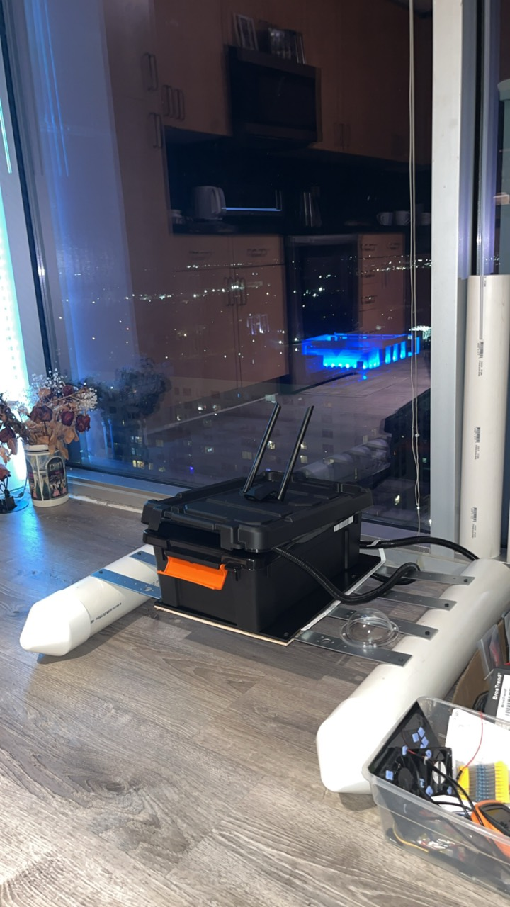
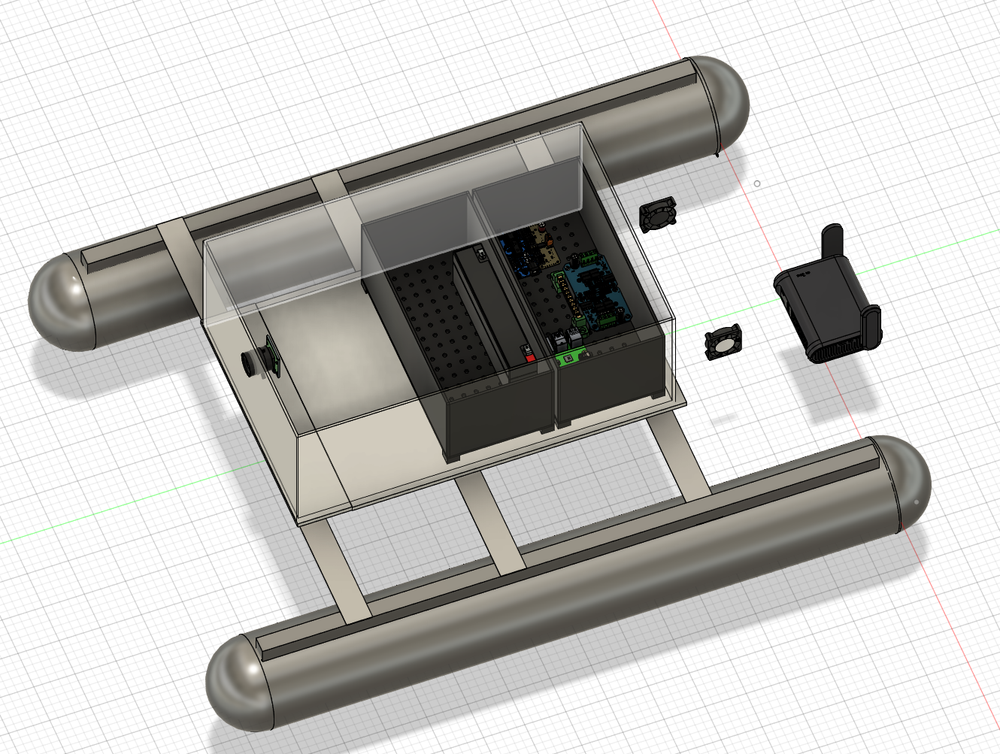
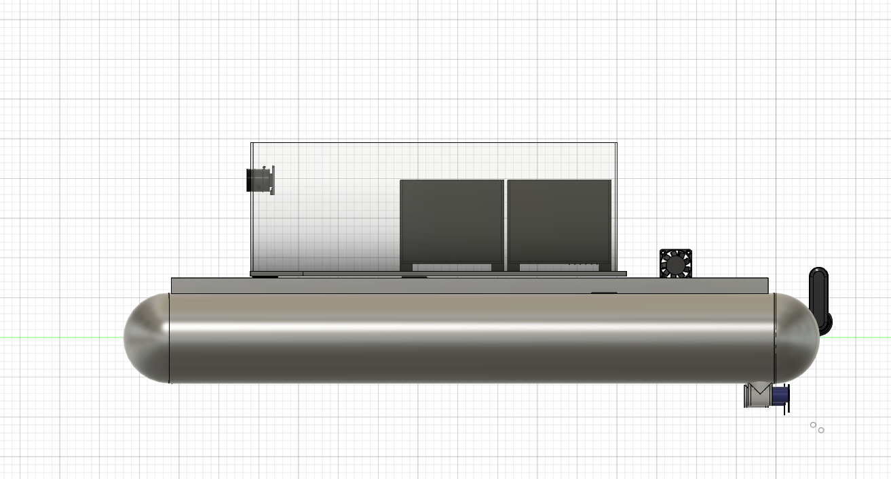

# Mechanical design

[Back to README](../README.md)

The hull uses two PVC floats joined by metal cross-members, with a central box for the electronics. Each pipe is 70 cm long, and the boat is approximately 70 cm wide.

*An earlier view of the hull assembly. The electronics and thrusters have since been installed.*

## CAD

I use Autodesk Fusion to work out the structure and possible component placement. The physical build has changed as I have worked on it, and the CAD model is still unfinished.

*A possible electronics layout. Wiring and final component positions are not included.*

*Side view of the unfinished model.*

The electronics are now installed, and I need to bring the CAD model up to date with the physical layout and wiring. The simulation also uses an earlier hull design.

## Enclosures and cooling

The electronics are mounted inside their box. I have used glue for the mounting pieces and cable ties to hold components and wiring in place. I still want to improve the routing and make it easier to get to parts when something needs replacing.

*The current electronics layout inside the box.*

I am still working on the cable entries and sealing. The assembled boat needs leak testing once those are finished.

Cooling is another problem I am working through. A sealed enclosure can trap heat, especially outside in Florida. I am considering heatsinks, fans, and a way to reduce direct sun on the box.

## Mounts

The thrusters are installed and respond to the control station. I still need to document the mounts, alignment, and propeller clearance.

I still need to measure the camera and IMU positions for calibration, including their orientation and distance from the boat's reference frame.

## Measurements

| Item | So far |
|---|---|
| PVC pipe length | 70 cm |
| Overall width | Approximately 70 cm |
| Overall length including end caps | Still to measure |
| Float and thruster spacing | Still to measure |
| Loaded mass | Still to measure |
| Loaded draft and freeboard | Still to test |

I still need to record the loaded weight, draft, and freeboard. I want those measurements with the actual battery and electronics load.
