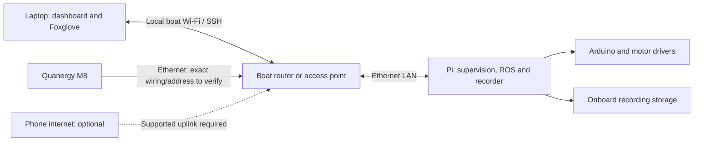

> Update: hardware identified as a BrosTrend AX4L USB Wi-Fi client, not a router. The confirmed phone-hotspot topology and recording/transfer workflow are in [recording workflow](recording-workflow.md). The router proposal below is historical and is not the selected topology.

# Deployment readiness and communications — 2026-11-11

## Current verdict

Not yet accepted for unattended water operation or a 30–60 minute synchronized collection mission. Software groundwork exists and Linux simulation runs, but physical power, actuator response, sensor timing, network behavior and storage endurance still need acceptance evidence. Passing desktop tests cannot establish these.

## Changes in this batch

- Invalid/no-fix/out-of-range GPS now immediately invalidates the previous safety position. Previously an invalid update could leave the old location available to commands.
- Set-fence-here and set-launch-here reject positions older than two seconds, including the interval before the periodic safety check runs.
- Runtime coordinates and warning fractions are validated before changing the fence or return point.
- Ground-control heartbeat expiry now uses monotonic elapsed time, independent of paused/jumping ROS time.
- Added `scripts/comms/connect-boat.ps1`, a foreground SSH tunnel helper for the dashboard and Foxglove. It checks forwarding failures and preserves SSH host-key verification. Dry-run was exercised; no live boat connection was made.
- Restored the missing ROS validation report linked by the runbook.

Validation: 200 Python tests passed, one pre-existing return-value warning. Eleven new safety cases cover invalid GPS, stale site capture, invalid configuration and timeout with a frozen ROS clock. Tests replace ROS I/O; these new changes still need a ROS runtime check.

## Two different boundaries

The geofence is an onboard navigation boundary. Foxglove displays data; it does not own the fence. Moving the laptop to another location does not move the boat's fence.

The network access restriction is separate. Dashboard and Foxglove listen on the Pi's loopback interface. SSH forwards them to the operator computer. A changed Wi-Fi network may change the Pi's address/reachability, but should not require removing authentication or opening public control ports.

## Automatic launch-site design — not enabled yet

Current hardware launch still requires explicit latitude, longitude and radius. The supervisor still captures its return point from the first valid fix. That is insufficient for reliable automatic commissioning; this batch does not claim to have completed automatic site selection.

Implement the following as one state machine, shared by supervision, UI and recorder:

1. BOOT / SITE_PENDING: propulsion inhibited; show why setup is pending. Load a persisted active-session anchor if present. Do not replace it just because the process restarted.
2. ACQUIRING: collect fresh, increasing acquisition timestamps and valid GPS status with reported accuracy. Require multiple consistent samples over a configured interval; reset on gaps, poor accuracy or jumps. Unknown accuracy must be visible, not interpreted as zero error.
3. SITE_READY: propose a fixed center and return point using the stationary boat's location. Display the selected operating radius and map boundary. Automatically fill coordinates; retain a deliberate launch/arm action. A GPS circle cannot determine whether the area includes shore, people, obstacles or restricted water.
4. ACTIVE: persist the accepted site/session identity atomically before permitting propulsion. Keep center and home fixed through GPS reacquisition, lost Wi-Fi and service restarts. Log changes and copy the site into the run manifest.
5. NEW_SITE: explicit action while stopped ends the old site and permits reacquisition. Do not infer a new site from distance travelled: that could remove a real breach.

Acceptance cases: no GPS; stale/replayed fixes; false first fix; accuracy unknown; unstable position; restart offshore; corrupt persisted state; movement during acquisition; operator cancel; changing site while moving; recording the same anchor in UI and manifest. The final acquisition thresholds depend on the actual GPS accuracy and measured behavior.

## AX1800 communication design

AX1800 is not an exact model. Both TP-Link Archer AX21 and ASUS RT-AX53U use that designation. Need manufacturer, full model/hardware revision and power label before prescribing router mode, voltage, cabling or firmware settings. No modem/router configuration has been changed.

Preferred local topology, subject to the actual device's ports/modes:



This is a proposed logical topology, not a verified wiring diagram. Do not connect the M8 power or assume PoE from this drawing. Check its exact power/interface documentation.

Keep the local control path available without internet. A laptop associated with a phone hotspot does not automatically join the boat router's LAN. Depending on the router, options include a supported hotspot uplink with laptop on the boat LAN, a second laptop network interface, or a routed VPN when both ends have internet. Avoid guessing which is supported. mDNS `.local` discovery can help on one LAN but is not guaranteed through routed/VPN networks; reserve the Pi address when the router supports it.

On a reachable network, from the repository in PowerShell:

```powershell
./scripts/comms/connect-boat.ps1 -BoatHost YOUR_PI_ADDRESS -PiUser YOUR_PI_USER
```

Keep the window open. Dashboard: `http://127.0.0.1:5000`; Foxglove websocket: `ws://127.0.0.1:8765`. First verify the Pi's SSH identity. This helper does not start the boat stack or reconnect automatically after a failure. Reconnecting transport must never re-arm thrust or resume a mission by itself.

Commission communications with propulsion disconnected: local access without phone internet; camera plus LiDAR-preview load; laptop sleep; router reboot; link loss and reconnection; address change; stale status indications; command timeout; no automatic mission resume. Measure latency/loss under recording load and at the intended range. Raw LiDAR storage should stay onboard; a bounded preview already exists for viewing.

## Work still required, in order

| Area | Existing groundwork | Acceptance still needed |
|---|---|---|
| Power and stop | Firmware watchdog, software STOP, thrust cap | Measured supply/ground wiring, fuse and wire sizing, motor stall budget, physical disconnect, stop timing under software/network failures |
| Launch site | Explicit fence and runtime site commands | Persistent automatic site acquisition/arming workflow above |
| Communications | Local bindings, SSH helper, heartbeat timeout | Exact AX1800 identification, LAN topology, router power and range/dropout tests |
| Actuator health | Motor status and reconnect latch | Propagate measured driver/watchdog faults to supervision and UI; verify propeller directions and thrust sign |
| GPS + IMU | Shadow EKF inputs/configuration | Actual timestamp/noise/mount calibration; absolute heading source; compare against reference before enabling navigation use |
| LiDAR | Optional M8 adapter builds on x86-64, bounded preview | Pi build, actual REV B packet reception, clock verification, mounting and power, point cloud validation |
| Recording | MCAP/QoS, manifests, sync/export and archive tools | Actual disk throughput, low-space behavior, crash recovery, timestamp alignment under full sensor load |
| Storage | Space reserve and duration-budget tool | Available capacity measured; 32 GB card cannot be assumed to hold this workload for an hour |
| Dataset | PNG/PCD export, provenance, archive hashes | Camera–LiDAR calibration; sample import into chosen 3D annotation tool and Roboflow; restore/replay copied run in Foxglove |
| Navigation | Idle simulation and safety tests | Mission movement, manual takeover, real heading, pause/rewind, return behavior; LiDAR obstacle avoidance is not implemented |
| Field procedure | Existing sensor runbook | Tethered low-power test, recovery method, operator checklist and recorded pass/fail evidence |

Raw 640×480 BGR at 10 frames/sec is about 33.2 GB/hour before LiDAR or other streams. Compression/rate choices must be measured, and storage capacity expanded if needed. Do not choose a session length from nominal card capacity alone.

## Information/photos to supply

- AX1800 underside label (model/revision/power) and ports; redact Wi-Fi/admin passwords.
- GPS model and antenna; IMU mounting orientation; LiDAR label and supplied cable/power connector.
- Whole power layout with readable fuse/buck labels and battery disconnected; include wire sizes if known.
- Pi storage type and actual free capacity; planned camera resolution/frame rate.

## Sources

- Raspberry Pi remote access and SSH: https://www.raspberrypi.com/documentation/computers/remote-access.html
- TP-Link AX21 identification: https://www.tp-link.com/us/home-networking/wifi-router/archer-ax21/
- ASUS AX53U identification: https://www.asus.com/uk/networking-iot-servers/wifi-routers/asus-wifi-routers/rt-ax53u/techspec/

Manufacturer pages establish that AX1800 is ambiguous; they do not identify the user's hardware or validate the proposed topology.
