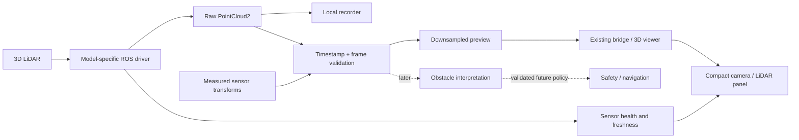

> Implementation update (2026-11-09): ROS 2 adapter source, preview, recorder and offline exports now exist. Hardware adapter compilation and physical commissioning remain pending. See [integration runbook](sensor-integration-runbook.md). The proposal below is retained as design history.

# 3D LiDAR integration plan

Status: proposed interfaces and layout, not an installed driver. User identifies the
purchased sensor as **Quanergy M8-1 REV B**, from eBay item 127928025894.
The listing could not be retrieved during this review; the model is user-reported,
not independently verified from its label. Revision-specific power, cable pinout,
firmware, calibration and mounting pose remain unverified.

## Quanergy M8-1 Rev B: integration decision

- **Data connection:** plan for Ethernet. Manufacturer documentation describes
  the M8 family using Ethernet. This does not establish that this Rev B unit accepts
  PoE, or establish its power voltage/pinout. Do not use M8 Prime or M8 PoE+
  specifications as substitutes for this older unit.
- **Driver:** the published Quanergy ROS wrapper uses CATKIN and roscpp (ROS 1),
  not a drop-in ROS 2 Jazzy package. The separate vendor C++ SDK produces PCL
  point clouds and includes visualization/reconnection examples. Its documented
  platforms include older Ubuntu releases and Windows; Pi ARM64/Jazzy compatibility
  has not been demonstrated here.
- **Proposed route:** first establish a short real capture using a compatible vendor
  tool/SDK. Then validate a maintained ROS 2 driver, or isolate a small ROS 2 C++
  adapter around the SDK. Do not introduce a ROS 1 bridge as an assumed dependency.
  Pin a tested SDK version and verify this sensor's packet/calibration support.
- **Network:** keep sensor traffic on a private wired boat-side subnet, with a
  distinct subnet from the shore link. Sensor IP, interface, routing and any switch
  needs must be confirmed from the actual setup. The shore UI receives a reduced
  preview; it should not require direct access to the sensor.
- **Power:** obtain the exact sensor label and supplied cable/breakout documentation
  before selecting a converter, fuse or connector. No wiring instructions or
  compatibility with the boat's 3S battery are established by this review.
- **First evidence needed:** clear photos of the complete label, all connectors,
  and both ends of any supplied cable/power box; seller-supplied manual and software
  if available. Then record firmware/version, SDK startup log, measured network
  rate and a stationary cloud with an object at a measured distance.

Sources: [Quanergy M8-family documentation](https://downloads.quanergy.com/qortex-dalmatian/QortexDTC-UserGuide-draft.pdf),
[official ROS package metadata](https://index.ros.org/p/quanergy_client_ros/),
[Quanergy SDK](https://github.com/QuanergySystems/quanergy_client).
These establish the family/software starting point, not Rev B electrical compatibility.

## Where it belongs

Keep raw capture and any future collision response on the boat. The laptop should
receive health, a bounded preview and operator controls; loss of preview must not
block the control watchdog. The Pi's actual CPU/network/storage capacity needs
measurement with camera and LiDAR running together.



The solid arrows describe the first implementation. Dashed arrows are later work:
a displayed point cloud is not yet collision avoidance. Invalid, stale or missing
scans must never be presented as verified free space.

Use `sensor_msgs/PointCloud2` for standard point clouds, with the acquisition stamp,
frame ID and field layout preserved. Vendor-specific packets or per-point timing
may also need recording for later motion compensation. The message is a binary
point layout, so consumers must read fields/strides rather than assuming every
vendor sends the same XYZ/intensity structure. [Official PointCloud2 definition](https://raw.githubusercontent.com/ros2/common_interfaces/jazzy/sensor_msgs/msg/PointCloud2.msg)

## Proposed code boundaries

| Component | Responsibility | Initial behavior |
| --- | --- | --- |
| Vendor driver launch | Connect to the exact supported device and publish raw measurements | Disabled unless explicitly configured |
| `boat_perception` LiDAR adapter | Topic normalization, input validation, health, preview downsampling | Display/record only; no propulsion command |
| `boat_description` | Measured `base_link` to `lidar_frame` mounting transform | No invented mounting values |
| `boat_msgs` sensor health message | Timestamped status usable by UI, recorder and future safety logic | Unknown/offline distinct from healthy |
| `boat_data` capture profile | Raw cloud, health, IMU, GPS, heading, TF/static TF and calibration identity | Opt-in LiDAR recording, measured storage budget |
| `boat_web_ui` | Small health indicator and switchable preview | No full cloud in `/telemetry` JSON |
| `boat_simulation` | Equivalent sensor/topic/frame contract for a simulated cloud | Never launch real vendor driver in simulation |

The first vendor driver should remain a separate dependency, not a copied block
inside web_server.py or motor_driver.py. Keep control authority in the arbiter.

Proposed topics (names are a contract draft, not currently implemented):

| Topic | Data | Consumers |
| --- | --- | --- |
| `/boat/lidar/points_raw` | PointCloud2, original acquisition stamp and fields | Recorder, validation/preprocessing |
| `/boat/lidar/points_preview` | Bounded/downsampled PointCloud2 | 3D viewer over the existing bridge |
| `/boat/lidar/status` | Stamped sensor status | UI, recorder, diagnostics |
| `/tf_static` | Calibrated rigid sensor transforms | Viewer, fusion, recorder |

Health should include enabled/configured/connected/data-fresh distinctions,
source frame, acquisition age, receive age, measured rate, point count, measured
bandwidth, transform validity, clock validity and a human-readable fault reason.
Vendor packet-loss metrics are optional; report unavailable when not supplied.
Avoid a single green “connected” light for a sensor delivering unusable geometry.

## Frames and time come first

The existing URDF lacks IMU/LiDAR frames and the runtime launch lacks a transform
publisher. Fix those before spatial fusion. Define the boat reference point and
measure each sensor's position and axes. Keep body `x` forward, `y` left, `z` up;
use a separate camera optical frame. [ROS coordinate conventions](https://raw.githubusercontent.com/ros-infrastructure/rep/master/rep-0103.rst)

Start with an instantaneous boat-relative cloud view. A geographically aligned
map or accumulated cloud also needs a validated dynamic pose and timing model.
The current GPS-course heading is not a measured bow orientation in current or
reverse motion. Do not use it to claim accurate camera/LiDAR registration.

Rolling/pitching and a moving scan may require per-point motion compensation.
Whether this is needed and which timestamps are available depend on the model.
A rigid mount transform alone cannot correct motion during acquisition.

## Data transport and storage

For live preview, propose a small latest-sample queue and best-effort delivery,
subject to compatibility with the chosen driver. Commands/receipts retain their
separate reliable path. Match publisher/subscriber QoS deliberately: an incompatible
pair can receive nothing. Static transforms need a replay/late-join policy, too.
[ROS 2 QoS documentation](https://raw.githubusercontent.com/ros2/ros2_documentation/jazzy/source/Concepts/Intermediate/About-Quality-of-Service-Settings.rst)

Measure raw bytes/s from `row_step * height * observed_hz`, not just an advertised
points/s number. Illustrative only: 100,000 points per scan at 16 bytes each and
10 scans/s is 16 MB/s (128 Mb/s), before overhead. That is not a specification
for your sensor. Current uncompressed RGB alone is about 9.2 MB/s before overhead.

Keep full-resolution recording local where practical. Send a reduced preview and
health across the radio. Provide configurable point budget, preview frequency,
region of interest and video quality; test command latency while both streams are
busy. Storage and CPU budgets must include decompression, filtering and viewer work.

## Compact UI layout

Preserve the current dense instrument column and central map. Make the existing
camera area a multi-view panel with **CAMERA | LIDAR | SPLIT** tabs. This gives the
LiDAR useful space without making the whole dashboard larger or adding a permanent
empty rectangle. On narrow displays show one view at a time; selecting a view must
not change control authority.

```text
┌─────────────┬──────────────────────┬─────────────────────────┐
│ Heading     │ Navigation map       │ CAMERA | LIDAR | SPLIT  │
│ Roll/pitch  │ Route / boat / dock   │ selected live view      │
│ Speed/power │                      │ age · rate · frame      │
├─────────────┼──────────────────────┼─────────────────────────┤
│ Thrust/STOP │ Mission controls     │ Events / sensor health  │
└─────────────┴──────────────────────┴─────────────────────────┘
```

Use the established muted green data and orange attention indicators. Show genuine
geometry with a clear metres scale and boat outline, not decorative radar sweeps.
Provide top/front/3D view choices, range and height filtering. Before configured,
show “LiDAR not configured”; during loss show the age and stale warning. A frozen
cloud must not look live. Keep STOP visible regardless of selected sensor tab.

Do not add an obstacle distance or “safe path” indicator until the algorithm defines
what counts as an obstacle and how unknown coverage is handled.

## Implementation stages and acceptance checks

1. **Identify:** exact model, manual/driver version, connector, input voltage/current,
   data interface, supported host/ROS version, time synchronization and protection rating.
2. **Bench capture:** receive real scans without motors, record a short bag, verify
   rate, timestamps and a known object's dimensions/directions. Disconnect the sensor
   and confirm stale status appears promptly.
3. **Measured mount:** add transforms, verify an object ahead appears ahead, and check
   roll/pitch while the boat is stationary. Record mount/calibration version.
4. **UI preview:** test camera/LiDAR switching, point budget, stale indication and command
   latency. Use local/network-loss tests with propulsion disconnected.
5. **Recording/replay:** repair the current recording defects first; verify all required
   topics, clock continuity, static transforms and identical replay geometry.
6. **Supervised water characterization:** log returns from docks, poles, nearby vessels,
   water and spray in relevant conditions. Do not infer clear water from absent returns.
7. **Later navigation policy:** define footprint, stopping distance, unknown-space policy,
   speed limits and fallback behavior before letting LiDAR influence propulsion.

Useful evidence to collect: sensor label and connector photos; mounting location from
top/side/front; measured offsets/angles from the boat reference; power label; driver
startup log; a 30–60 second stationary scan; and a recording of slow known rotations.

No driver or fake scan publisher has been added. The model is now identified by the
user; revision-specific electrical and driver compatibility still require verification.
