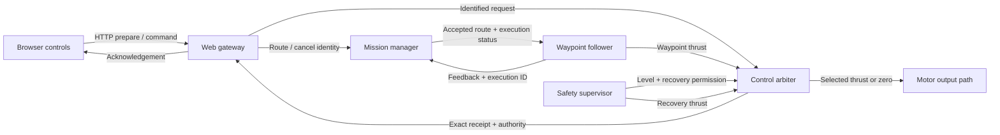
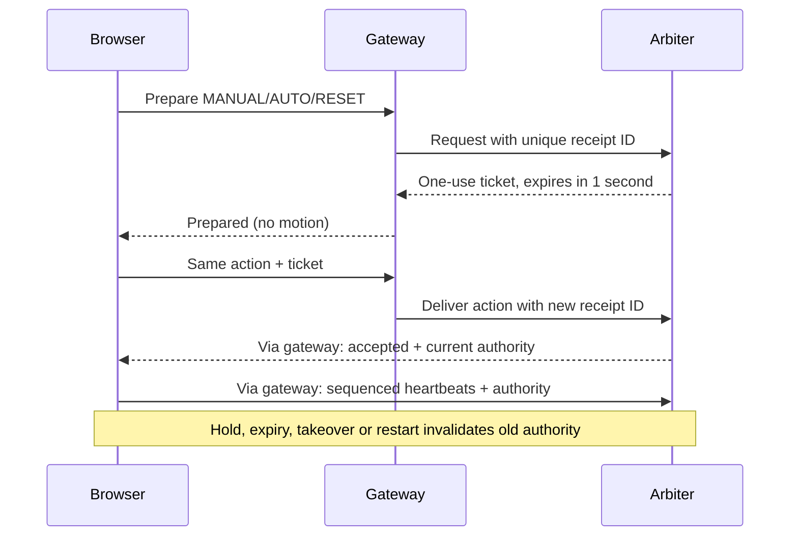

# Operator control contract

Updated 7 November 2026 on `fix/operator-handover`. Local implementation and
offline verification only; not deployed to the Pi or tested with motors.

## Operator behavior

| Situation/action | Result |
| --- | --- |
| Arbiter starts or restarts | HOLD, zero commanded thrust; no automatic arming |
| Take Manual / WASD | Acknowledged manual authority; release keys for neutral |
| Hold | Zero thrust, retained route and target |
| Start Mission | Hold, identified route acceptance, then explicit AUTO |
| Continue Mission | Fresh authorization; continue retained route |
| Cancel Mission / Cancel + Clear Route | Hold, cancel the identified execution, clear drawing after acknowledgement |
| Clear Points | Clears the unsubmitted draft points |
| E-stop | Stops regardless of which browser previously owned control; aborts mission |
| Reset to Hold | Clears e-stop through the sequenced protocol; does not resume |
| Lost command heartbeat | HOLD after the one-second lease timeout; reconnection cannot silently resume |
| Missing or stale safety supervision | Motion refused / HOLD |
| Safety restriction clears | Explicit Continue required; no automatic mission resumption |

Hold means zero propulsion, not station keeping. Current and wind can still move
the boat. Dashboard motor bars are requested thrust, not measured motor output.

Manual recovery is permitted for supervisor-identified navigation restrictions
such as geofence/link recovery, including degraded recovery without navigation
sensors. It still needs a fresh supervisor and a working operator command link.
E-stop, level-4 stop, and a level-3 stop without explicit manual-recovery permission
block manual thrust. This does not add electrical fault detection: future fault
sources must explicitly withhold recovery permission.

The command-link policy is HOLD in both MANUAL and AUTO. The existing safety
controller's return-to-launch capability does not override that Hold. Autonomous
return after loss of the operator link remains a separate policy decision.

## How the pieces fit



The browser requests control; the arbiter decides whether it is allowed. The
mission manager decides which route exists. The follower calculates steering only
for that execution and pauses progress while manual control or Hold is active.
The safety supervisor supplies restrictions and recovery steering. All commanded
propulsion passes through the arbiter.



Ticket expiry uses the arbiter's monotonic clock. The browser also refuses a
preparation taking one second or longer. Tickets are bound to the action payload
and consumed once. Sequence numbers order commands within an owner session;
authority generations prevent old renewals from reclaiming a newer session.
HOLD and e-stop do not require a motion ticket. These mechanisms prevent stale
control actions; they are not authentication or encryption.

Each HTTP attempt gets a fresh request ID, so cached success for an earlier
attempt cannot confirm a command that was never delivered. Timeouts mean an
uncertain outcome: remain held and inspect current state before retrying.

Mission requests carry the manager instance and expected generation. The manager
assigns a fresh execution ID to each accepted route. Completion, cancellation and
follower status must match that execution. The follower requires matching status
no older than 1.5 seconds; an old completion cannot finish a replacement route.
Manager restart invalidates queued requests from the previous instance.

## Code reading order

1. `src/boat_web_ui/boat_web_ui/operator_controls.js`: transition preparation,
   acknowledgements, heartbeat and stale-response handling.
2. `src/boat_control/boat_control/arbitration.py`: `on_operator_command()` and
   `evaluate()` implement authority and propulsion selection.
3. `src/boat_control/boat_control/control_arbiter.py`: ROS adapter and receipts.
4. `src/boat_control/boat_control/mission_state.py` and `mission_manager.py`:
   execution identity, acceptance, cancellation and timeout.
5. `src/boat_navigation/boat_navigation/waypoint_follower.py`: identity/freshness
   gates and progress pause.
6. `src/boat_web_ui/boat_web_ui/web_server.py`: HTTP validation and exact receipts.

## Build compatibility

Rebuild the complete workspace and restart the participating nodes together.
`boat_msgs/MissionCommand` and `boat_msgs/FailsafeState` changed. Mission cancel
is now String JSON instead of Empty; feedback is identified JSON instead of an
anonymous string. Reload the browser after installation. Mixed old/new nodes are
unsupported. `boat/mission_status`, `boat/operator_command` and
`boat/operator_status` are now included in recorder defaults.

Legacy split manual/control-mode inputs are disabled in the production arbiter.
Some old unit fixtures explicitly enable compatibility behavior; they do not
describe production startup. Raw old CLI mission messages no longer work.

## Offline verification and remaining validation

Final offline run: **109 targeted checks passed**, all 61 Python source files
parsed, and `git diff --check` passed. The test log is in the desktop work folder
at `outputs/asv-control-verification-2026-11-07/test-results.txt`.

Run these from the repository root with Python 3 and Node:

```sh
python3 src/boat_control/test/test_control_logic.py
python3 src/boat_control/test/test_failsafe_logic.py
python3 src/boat_control/test/test_operator_handover.py
python3 src/boat_control/test/test_control_contract.py
python3 src/boat_control/test/test_mission_protocol.py
python3 src/boat_web_ui/test/test_operator_endpoint.py
node --test src/boat_web_ui/test/operator_controls.test.cjs src/boat_web_ui/test/pilot_page.test.cjs
```

Set `PYTHON` to the Python executable for the composed-page test. These cover pure
logic, actual adapter methods with in-memory transport, and actual page JavaScript
with a fake DOM/map/network. They do not exercise real Flask HTTP, ROS/DDS, Wi-Fi,
firmware, or physical stopping time. ROS/ament dependencies are unavailable on
this desktop; the ROS lint suite and generated interface build remain unverified.

Before propulsion, rebuild and run the full stack in simulation without the motor
node. Use `scripts/sim/verify_control_loop.sh`, then specifically test stopped
startup, safety-monitor absence, manual takeover, Hold/Continue, cancel/new route,
manager/follower/arbiter restarts, late messages, link loss and e-stop/reset. Record
actual thrust and status topics. Then verify the motor controller's independent
watchdog and stop path on the bench. Offline checks are not water-test clearance.
