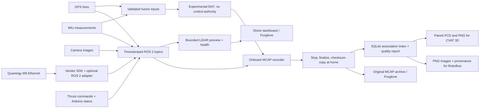

> Latest validation: see [ROS build and simulation results](reviews/2026-11-09-ros-validation.md). Linux compilation and initial DDS/simulation checks have now run; physical commissioning is still pending.

# Sensor integration and recording runbook

Updated 2026-11-09. Target: Quanergy M8-1 REV B, GPS, IMU, camera and dual thrusters; 30–60 minute sessions. This is implementation groundwork, not hardware acceptance.

## What exists and what is unverified

Implemented: optional ROS 2 Quanergy SDK adapter source, bounded preview, sensor health, experimental GPS/gyro EKF inputs/configuration, MCAP recorder profile, offline association/quality reports, PNG/PCD exports and checksum-verified archival copying.

Verified: offline synthetic MCAP round trips, Python/control/browser regression tests, an x86-64 ROS 2 Jazzy workspace build, optional vendor SDK/adapter compilation, initial DDS safety checks and initial simulation sensor streams. See the linked validation report for evidence and limitations. Not verified: ARM/Pi build and performance, complete live TF/QoS integration, actual robot_localization behavior, physical sensor timing or hardware wiring. Default workspace builds leave the hardware adapter OFF. None of this changes steering to use the experimental EKF or LiDAR avoidance. See [deployment readiness](deployment-readiness.md) for the current field checklist and communications plan.

## System layout



Record onboard so a Wi-Fi outage does not inherently remove the capture path. Shore preview is reduced independently of full raw-cloud recording. The recorder and navigation remain separate processes. Wi-Fi security, modem routing and unattended recovery still require commissioning; this work does not establish that network.

## Storage: 32 GB card is not a 60-minute guarantee

A 640×480 BGR8 image stream at 10 Hz alone is 9.216 MB/s: 16.59 GB per 30 minutes or 33.18 GB per hour. This excludes LiDAR, other streams, metadata, OS usage and reserve space. The camera settings and actual aggregate rate must be measured; these numbers are an example, not a measured boat rate.

The recording launch requires 5 GB free to start, splits bags at about 1 GB, and requests stop below a 2 GB reserve. These safeguards do not make a full card suitable for the requested duration. Do a short representative recording and measure total size divided by elapsed seconds. Use decimal MB/s, not megabits/s:

```sh
python scripts/storage_budget.py --free-gb 24 --reserve-gb 2 --mbps 10 --minutes 60
```

This example intentionally fails the capacity estimate. The script includes 25% margin. For full camera + LiDAR sessions, plan additional onboard storage, or explicitly choose and validate compression/frame rates before collection. No automatic data deletion or silent reduction in quality is implemented. USB storage also needs a mounting, power and sustained-write test. Do not put the recording directory on an unmounted fallback root path.

## Quanergy bring-up

1. Obtain photos of the sensor model/revision label, all connectors and supplied cables; obtain its exact manual. Verify voltage, pinout and Ethernet arrangement before power. The code does not establish whether this unit supports PoE.
2. Build the optional adapter on the intended ROS 2 Linux machine following `src/boat_lidar/README.md`. Verify SDK settings/calibration against the physical device.
3. Begin with receive timestamps, motors disconnected, and only inspect clouds/health. Supply the actual sensor address; no assumed device IP is embedded.
4. Verify the sensor clock against the recording host before using sensor timestamps. GPS UTC and host clock must also agree. Merely setting a flag does not synchronize clocks.
5. Measure the sensor mounting transform. Without it, clouds can be inspected in `lidar_frame`, but should not be shown as calibrated vessel geometry.

```sh
ros2 launch boat_lidar quanergy.launch.py host:=ACTUAL_SENSOR_IP timestamp_mode:=receive
# Only after clock verification and measured mounting calibration:
ros2 launch boat_lidar quanergy.launch.py host:=ACTUAL_SENSOR_IP timestamp_mode:=sensor sensor_clock_verified:=true calibration:=/absolute/calibration.json
```

Primary topics: `/boat/lidar/points_raw`, `/boat/lidar/points_preview`, `/boat/lidar/driver_status`, `/boat/lidar/status`. Preview is capped at 10,000 points and 5 Hz by default. The dashboard badge reports availability/timing status; Foxglove is the 3D viewing path. There is no in-page 3D renderer or collision avoidance yet.

The SDK produces processed clouds, not a lossless network-packet archive. The current cloud interface does not supply a validated per-point acquisition-time model; no motion deskew is applied. Driver reconnection and shutdown under network failure need physical testing.

## EKF commissioning

Copy `src/boat_navigation/config/calibration.template.json` outside the template and fill measured datum, sensor positions/orientations and noise variances. Set `verified` only after measurement. Units are meters, radians, degrees for latitude/longitude, and the variance units in the JSON names. Do not substitute guessed zero transforms.

```sh
ros2 launch boat_navigation fusion_shadow.launch.py calibration:=/absolute/calibration.json
```

This uses fixed-datum ENU GPS position and IMU yaw rate in a 2D robot_localization EKF. It estimates the GPS antenna position. It does not correct that position to the hull origin using an unobserved heading. Absolute yaw remains unverified; acceleration and IMU orientation are not fused. Output is `/boat/localization/odometry`, with separate input-health status. A freshly published prediction is not proof that sensors remain healthy.

Do not run another static-transform publisher for the same GPS/IMU child frames, including an old display URDF with placeholder mounts. GPS-to-IMU lever-arm behavior, axis orientation, gyro bias, heading observability and covariance tuning must be evaluated with recorded stationary and moving trials before control integration.

## Recording and returning home

```sh
ros2 launch boat_data recording.launch.py data_root:=/absolute/mounted/data calibration_file:=/absolute/calibration.json
```

The recorder starts idle. Start/stop from the Data page. HTTP 202 means dispatched, not confirmed; watch fresh recorder status and actual disk-writing status. Keep recording until the desired end, then stop and allow finalization/checksums before copying or removing storage. A forced shutdown is marked in the manifest. Checksumming a large run can take time.

For offline tools install `scripts/requirements-dataset.txt` in a Python virtual environment. Commands below run from the repository root, with the source package on PYTHONPATH (or use the installed `ros2 run boat_data dataset` entry point):

```sh
export PYTHONPATH="$PWD/src/boat_data"
python -m boat_data.dataset archive /boat/run /archive/new-run
python -m boat_data.dataset index /archive/new-run
# Use the exact index.sqlite path printed by index:
python -m boat_data.dataset export /archive/new-run /archive/new-run/derived/dataset-v1-ID/index.sqlite --every 10
python -m boat_data.dataset export-3d /archive/new-run /archive/new-run/derived/dataset-v1-ID/index.sqlite --every 10
```

`archive` refuses an unfinished run, existing destination or checksum mismatch. It copies into a staging directory, verifies hashes, and then renames; source data is retained. Keep a second verified copy before deleting anything from the boat. The script does not upload to cloud accounts.

`index` reads split MCAP files and stores metadata in SQLite instead of loading all imagery/clouds into RAM. Quality reports identify missing streams, invalid fixes, missing timestamps, clock reversals and rejected associations. The default requires all five modalities. `--without-lidar` is an explicit pre-delivery camera/GPS/IMU/thrust collection mode.

Association tolerances: GPS 200 ms, IMU 50 ms, LiDAR 150 ms, and latest prior thrust command within 500 ms. A future thrust command is never substituted. These are initial acceptance windows, not proof of physical synchronization. Receive-time LiDAR is rejected for synchronized training export. Camera exposure time and Arduino IMU receive latency still need characterization. Arduino status is host-receive-timed; reported motor percentages are not measured thrust, and current readings remain ADC counts rather than amperes.

Image export creates PNGs and provenance. 3D export creates paired same-basename PCD/PNG assets and provenance, preserving source cloud coordinates. It does not project labels, deskew clouds, calibrate camera-to-LiDAR geometry or invent annotations. Some image pairs may share the same nearest cloud. Split training/validation/test by entire run/site/session, not neighboring frames. Roboflow is the image branch; CVAT-compatible PCD/context imagery is the prepared 3D branch. Annotation re-import, dataset version registry and automated external uploads remain future work.

## Photos and measurements needed from you

- LiDAR label, connectors, cables and supplier/manual details when it arrives.
- Whole boat from above and from the side; mark bow and the intended base-frame origin.
- Close-ups and model labels of GPS antenna/receiver, IMU board, camera and storage.
- Sensor mounting positions relative to the origin, and the direction of each sensor's axes.
- Camera resolution/frame rate, lens/calibration information, and whether focus can change.
- Actual card capacity/free space and a short run's measured size/rate. Confirm whether you can add onboard storage for 30–60 minute full-sensor runs.

## Remaining acceptance gates

Build on target ROS 2; launch with actual TF tree; test input loss, clock jumps and disk pressure; benchmark CPU/memory/write rates; verify mount/calibration; characterize synchronization; record stationary and moving trials; replay in Foxglove; inspect image/PCD alignment; then consider navigation integration. This sequence avoids treating source-code completion as hardware validation.
